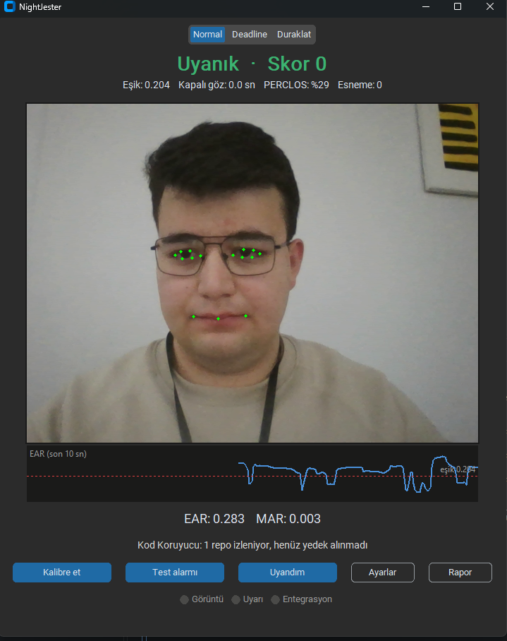
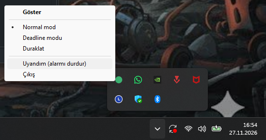

# Night Jester 🃏🌙

**Takım:** Embedded Mind · **Etkinlik:** GDG PAU Hackathon · **Tema:** Yazılımcının hayatını kolaylaştırmak

Night Jester, bilgisayar kamerasıyla yazılımcının uykusunun gelip gelmediğini **tamamen lokalde** tespit eden ve arka planda (system tray) çalışan bir masaüstü uygulamasıdır.

- **Normal mod:** Yorgunluk fark edildiğinde nazik bir mola / uyku hatırlatması yapar.
- **Deadline modu:** Uyuyakaldığında seni seçtiğin sesle, rastgele seçilen bir video linkiyle ya da video dosyasıyla uyandırır. Aynı anda **Kod Koruyucu**, çalışma alanına dokunmadan kodunun git yedeğini alır.



---

## Öne çıkanlar

| | |
|---|---|
| 🎯 **Kişiye özel kalibrasyon** | Açılışta 5 sn'lik ölçümle senin gözlerine göre eşik belirlenir. Gözlükle de çalışır. |
| 👁️ **Çok işaretli tespit** | Kesintisiz kapalı göz süresi, PERCLOS (son 60 sn'de gözlerin kapalı kalma oranı), esneme sayacı ve "kafa düştü" kuralı. Normal göz kırpma alarm tetiklemez. |
| 🛡️ **Kod Koruyucu** | Uyku anında `git stash create` + `git stash store` ile değişikliklerin yedeklenir. Dosyalarına, index'e ve commit geçmişine **dokunulmaz**. |
| 🔔 **Kişiselleştirilebilir uyandırma** | Kadın/erkek ses, kendi alarm sesin, rastgele seçilen video linkleri veya bir video dosyası. Alarm sesi kademeli yükselir. |
| 🔒 **Gizlilik** | Görüntü hiçbir yere gönderilmez ve diske kaydedilmez. Tüm işlem bilgisayarında yapılır. |
| 📊 **Yorgunluk raporu** | Oturum boyunca Uykulu / Uyuyor olaylarının saatlere göre dağılımı. |
| 🧩 **Arka planda çalışma** | Pencereyi kapatınca tray'e küçülür. Tray ikonunun rengi durumu gösterir. |

<p>
  
  
</p>

---

## Nasıl çalışır?

1. **Kamera** kareleri okunur ve aynalanır (OpenCV).
2. **MediaPipe FaceLandmarker** yüzde 478 nokta bulur. Bu noktalardan iki ölçüm hesaplanır:
   - **EAR (göz açıklık oranı):** `(|p2 − p6| + |p3 − p5|) / (2 · |p1 − p4|)`, göz kapandıkça 0'a yaklaşır.
   - **MAR (ağız açıklık oranı):** Esneme tespiti için kullanılır.
3. **Durum makinesi** bu ölçümleri yorumlar: `Kalibrasyon → Uyanık ⇄ Uykulu ⇄ Uyuyor`, yüz yoksa `Yüz yok`.

   | Geçiş | Koşul (varsayılan) |
   |---|---|
   | Uyanık → Uykulu | Gözler ≥ 1,5 sn kapalı, **veya** PERCLOS > %25, **veya** son 5 dk'da ≥ 3 esneme |
   | → Uyuyor | Gözler ≥ 3 sn kapalı, **veya** Uykulu iken yüz kaybolursa (kafa düştü) |
   | → Uyanık | Gözler ≥ 2 sn kesintisiz açık |

4. **Moda göre tepki:**

   | | Normal mod | Deadline modu |
   |---|---|---|
   | Uykulu | Bildirim + "you look tired" sesi | "you look tired" sesi |
   | Uyuyor | Bildirim + "you look sleepy" sesi | Alarm / video + Kod Koruyucu yedeği |
   | Uyanınca | — | Alarm durur, "Hoş geldin, kodun güvende" bildirimi |

**Mimari:** Her modül kendi thread'inde çalışır ve modüller birbirleriyle sadece yayınla/abone ol (pub/sub) altyapısı üzerinden konuşur (`libs/communicator`). Kritik hatalar tek bir bitmask'te tutulur ve paneldeki 3 durum göstergesiyle gösterilir (`libs/device_state_tracker`). Ayrıntılar için [PLAN.md](PLAN.md).

```
camera_capture → face_analyzer → fatigue_detector → alert_manager / code_guardian / session_logger / ui
```

---

## Kurulum (Windows 10/11)

**Gerekenler:** [Python 3.12](https://www.python.org/downloads/) (64-bit), [Git for Windows](https://git-scm.com/download/win), bir web kamerası.

```powershell
git clone https://github.com/BekirBeratKurt/GDG_PAU_HACKATHON_NightJester.git
cd GDG_PAU_HACKATHON_NightJester
py -3.12 -m venv .venv
.venv\Scripts\python.exe -m pip install --upgrade pip
.venv\Scripts\python.exe -m pip install -r requirements.txt
```

Geliştirme araçları (testler ve lint) için ayrıca:

```powershell
.venv\Scripts\python.exe -m pip install -r requirements-dev.txt
```

**Model dosyası:** `assets/models/face_landmarker.task` repoyla birlikte gelir. Eksikse MediaPipe Face Landmarker sayfasının *Models* bölümünden indirip bu yola koy.

**Kamera izni:** *Ayarlar → Gizlilik ve güvenlik → Kamera → Masaüstü uygulamalarının kameraya erişmesine izin ver* açık olmalı.

## Çalıştırma

```powershell
.venv\Scripts\python.exe main.py
```

Açılışta **5 sn boyunca ekrana normal şekilde bak**, kalibrasyon bitince durum "Uyanık" olur.

---

## Kullanım

| Kontrol | Ne yapar |
|---|---|
| **Normal / Deadline / Duraklat** | Çalışma modu. Duraklat'ta tespit sürer ama uyarı verilmez. Tray menüsüyle senkronizedir. |
| **Kalibre et** | Kalibrasyonu yeniden yapar (ışık değişince veya gözlük takıp çıkarınca). |
| **Test alarmı** | Tespitten bağımsız olarak Deadline uyandırmasını dener. |
| **Uyandım** | Alarmı hemen durdurur. Alarm çalarken kırmızıya döner. |
| **Ayarlar** | Medya seçimi, tespit eşikleri, Kod Koruyucu repoları. Kaydedince değişiklikler **yeniden başlatmadan** uygulanır. |
| **Rapor** | Bu oturumdaki Uykulu / Uyuyor olaylarını saatlere göre gösterir. |
| **Pencereyi kapatma (X)** | Uygulama kapanmaz, tray'e küçülür. Tamamen kapatmak için tray menüsünden **Çıkış**'ı seç. |

**Durum göstergeleri** (pencerenin altındaki 3 nokta): **Görüntü** (kamera + model), **Uyarı** (ses), **Entegrasyon** (git + ayarlar). Normalde gri kalırlar, sorun varsa kırmızı yanarlar. Aynı göstergedeki farklı sorunlar desenle ayrılır (sürekli / hızlı / yavaş yanıp sönme), sorunun açıklaması altında yazar.

### Kod Koruyucu

1. **Ayarlar → Kod Koruyucu** sekmesinde **Klasör ekle** ile çalıştığın git reposunu ekle.
2. **Deadline** modunda uyuyakalırsan, repoda değişiklik varsa `nightjester: uyku anı <zaman>` adlı bir yedek alınır. Dosyaların olduğu gibi kalır.
3. Yedeği geri yüklemek için (PowerShell'de `stash@{n}` mutlaka **tek tırnak** içinde yazılmalı):

```powershell
git stash list
git stash show -p 'stash@{0}'     # içeriğe bak
git stash apply 'stash@{0}'       # geri yükle (yedek listede kalır)
```

> Kod Koruyucu sadece **diskteki** değişiklikleri görür. VS Code'da `files.autoSave = afterDelay` ayarını açman önerilir (*File → Auto Save*). Hiç `git add` yapılmamış yeni dosyalar yedeğe girmez.

### Sesler ve videolar

Varsayılan sesler `def_voice_files/<female|male>/` altındadır:

```
Drowsy/             → Uykulu uyarısı (iki modda)
Sleepy/normal/      → Normal mod uyku hatırlatması
Sleepy/deadline/    → Deadline alarmı (döngüde çalar, sesi yükselir)
```

Her klasördeki dosyalardan **rastgele** biri çalınır, yeni ses eklemek için dosyayı klasöre koyman yeterli. Desteklenen formatlar: **`.wav`, `.ogg`, `.mp3`**. `.m4a` dosyaları desteklenmez, şu komutla çevirebilirsin (ffmpeg gerekir):

```powershell
ffmpeg -i ses.m4a -vn -c:a libvorbis -q:a 5 ses.ogg
```

Deadline'da video kullanmak için **Ayarlar → Uyarılar** sekmesinde *Deadline uyandırma* seçeneğini **Video linki (rastgele)** yap ve linkleri her satıra bir tane gelecek şekilde yaz. Uykuda listeden rastgele biri tarayıcıda açılır. Link açılamazsa yedek olarak alarm sesi çalar.

---

## Ayarlar

Ayarların varsayılanları [config/default_config.json](config/default_config.json) dosyasındadır. Ayarlar ekranı değişikliklerini `config/user_config.json` dosyasına yazar (sadece varsayılandan farklı olanları). Bu dosyayı elle de düzenleyebilirsin. Sık kullanılanlar:

| Ayar | Varsayılan | Açıklama |
|---|---|---|
| `fatigue_detector.drowsy_closed_sec` | 1.5 | Uykulu için kesintisiz kapalı göz süresi (sn) |
| `fatigue_detector.asleep_closed_sec` | 3.0 | Uyuyor için kapalı göz süresi (sn) |
| `fatigue_detector.ear_closed_ratio` | 0.75 | Göz kapalı eşiği = kalibre edilen EAR × bu oran |
| `fatigue_detector.perclos_drowsy_threshold` | 0.25 | PERCLOS eşiği |
| `alert_manager.voice_gender` | female | `female` / `male` |
| `alert_manager.deadline_media_type` | sound | `sound` / `video_url` / `video_file` |
| `alert_manager.deadline_video_urls` | [] | Rastgele seçilecek video linkleri |
| `alert_manager.normal_mode_cooldown_sec` | 10 | Normal mod hatırlatmalarının en sık tekrar aralığı (sn) |
| `code_guardian.repo_paths` | [] | Yedeklenecek git repoları |
| `camera.index` | 0 | Kamera numarası (değişince yeniden başlat) |

---

## Sorun giderme

| Belirti | Çözüm |
|---|---|
| `.venv\Scripts\activate` "running scripts is disabled" hatası veriyor | Etkinleştirmeden `.venv\Scripts\python.exe main.py` ile çalıştır, ya da bir kez `Set-ExecutionPolicy -Scope CurrentUser RemoteSigned` çalıştır. |
| "Kamera görüntüsü yok", **Görüntü** göstergesi sürekli yanıyor | Kamera iznini kontrol et, kamerayı kullanan diğer uygulamaları (Teams, Zoom) kapat, ayarlardan kamera indeksini değiştir. |
| **Görüntü** göstergesi yavaş yanıp sönüyor | `assets/models/face_landmarker.task` dosyası eksik. |
| **Uyarı** göstergesi yanıyor | Ses klasörü boş, dosyalar `.m4a` formatında ya da seçilen özel alarm sesi bulunamıyor. |
| **Entegrasyon** göstergesi hızlı yanıp sönüyor | Kod Koruyucu'daki bir repo yolu geçersiz veya git kurulu değil. |
| Tray ikonu görünmüyor | Windows 11 yeni ikonları gizli alana koyar: görev çubuğundaki **^** okuna tıkla. |
| Klavyeye bakarken yanlışlıkla "Uykulu" oluyor | Ayarlardan *Göz kapalı eşiği*ni düşür (ör. 0.70) veya *Uykulu için kapalı göz* süresini artır, sonra **Kalibre et**. |

---

## Geliştirme

```powershell
.venv\Scripts\python.exe -m pytest           # birim testleri
.venv\Scripts\ruff.exe check .               # lint
.venv\Scripts\ruff.exe format --check .      # biçim
```

```
main.py                  ince giriş noktası: ayarlar, topic'ler, task'lar, arayüz
libs/communicator        task'lar arası pub/sub (topic'ler ve veri tipleri: topics.py)
libs/device_state_tracker  kritik hata bitmask'i + gösterge desenleri
libs/config_manager      varsayılan + kullanıcı ayarları
libs/camera_capture      kamera
libs/face_analyzer       MediaPipe → EAR, MAR
libs/fatigue_detector    kalibrasyon + durum makinesi
libs/alert_manager       bildirim, ses, video
libs/code_guardian       git yedeği
libs/session_logger      SQLite oturum kaydı + saatlik rapor
libs/ui                  panel, ayarlar, rapor, tray
tests/                   birim testleri
tools/prepare_demo_repo.ps1  demo için Kod Koruyucu test reposu
```

**Teknolojiler:** Python 3.12 · OpenCV · MediaPipe Tasks (FaceLandmarker) · NumPy · CustomTkinter · Pillow · pystray · pygame · plyer · SQLite · Ruff · pytest

---

*Embedded Mind tarafından GDG PAU Hackathon için geliştirildi.*
